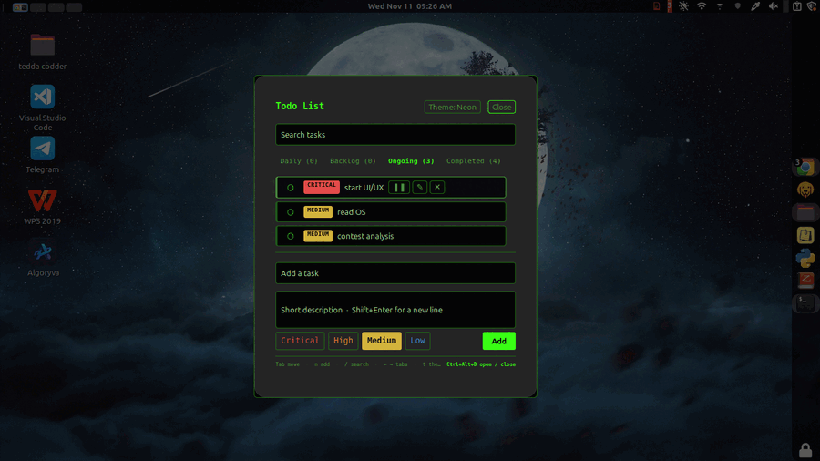
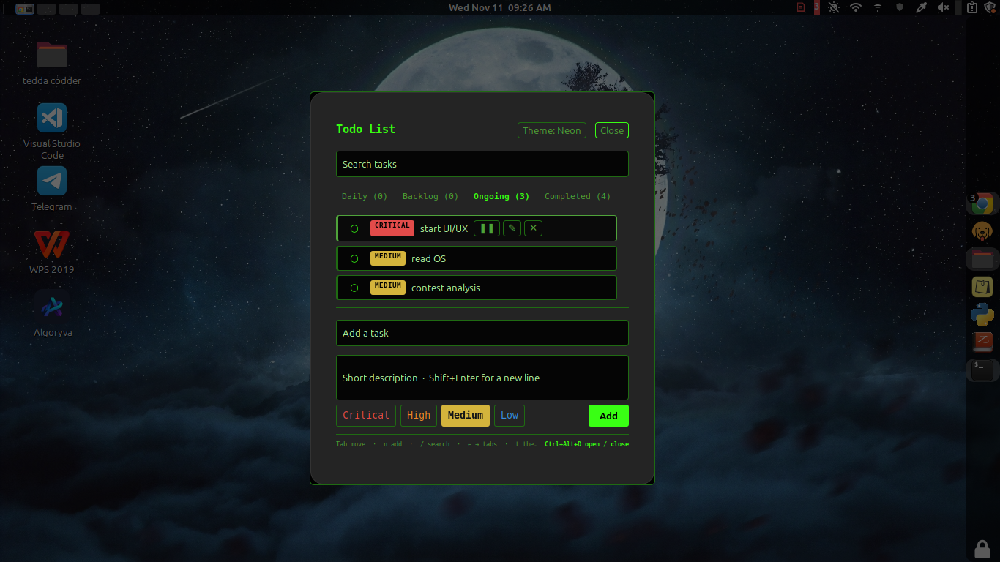
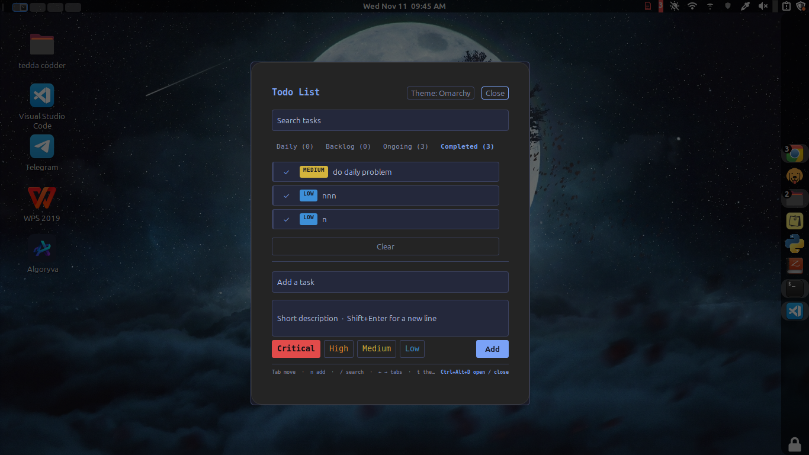
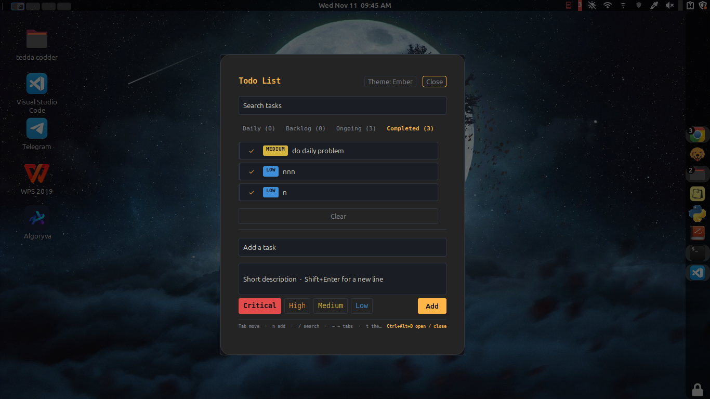
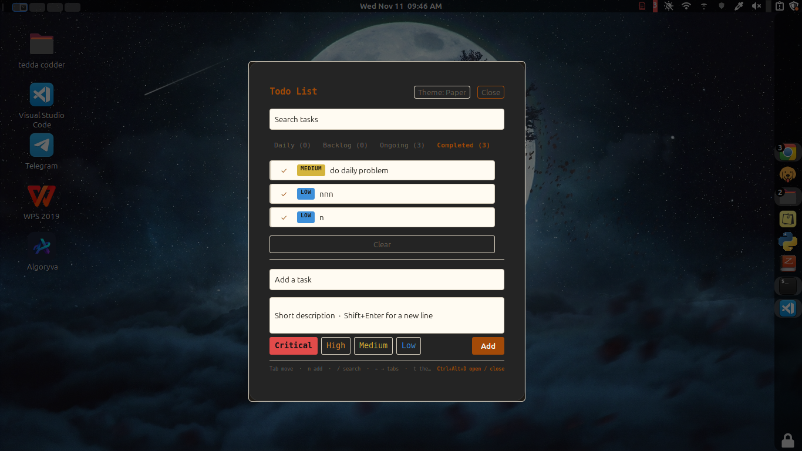
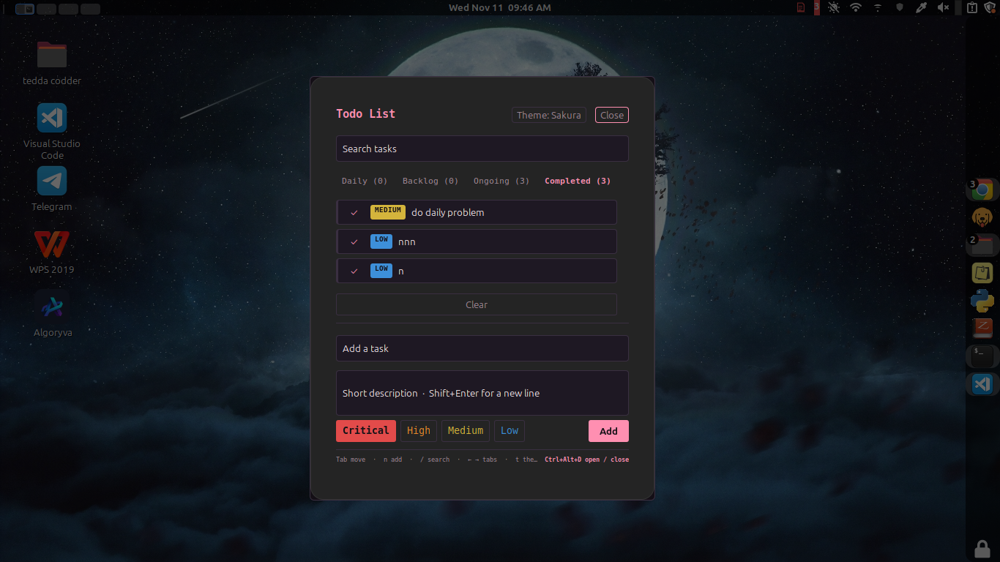
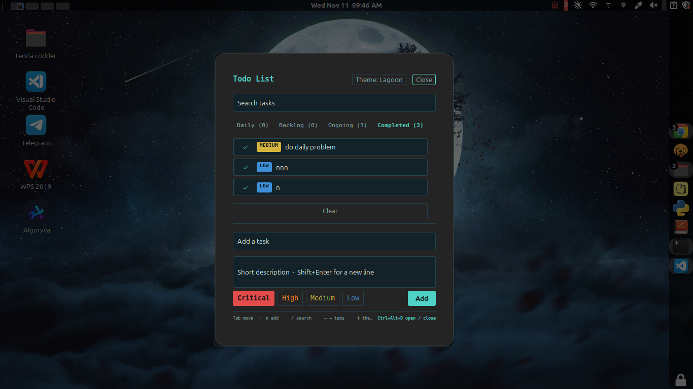

# Todo List for Cinnamon

A short, prioritized todo list in your Cinnamon panel. The panel icon shows how
many tasks are ongoing, coloured by the most urgent one. Open the list with a
click or with **Ctrl+Alt+D**. Everything works from the keyboard.



A port of [check_ur_todo](https://github.com/Aston-lewis/check_ur_todo), which is
based on [omarchy-priority-todos](https://github.com/dejan994/omarchy-priority-todos)
by Dejan V. Both are MIT licensed.

> [!NOTE]
> Your tasks stay on this machine, in `~/.local/state/todo-list/todos.json`.
> The applet makes no network connections and installs no packages.

## Quick start

```bash
cd ~/LinuxUI/todo-list
bash install.sh
```

Restart Cinnamon: press Alt+F2, type `r`, and press Enter. Right-click the panel,
choose **Applets**, and add **Todo List**. Press **Ctrl+Alt+D** to open it.

> [!IMPORTANT]
> If you added Ctrl+Alt+D earlier as a Cinnamon custom shortcut, remove it first.
> Otherwise one press opens and closes the window straight away.
>
> ```bash
> bash scripts/set-shortcut.sh --remove
> ```

## Status

Tested on Linux Mint 22 with Cinnamon 6.6 on X11.

Confirmed in a real session:

- The panel icon loads, and the window opens and closes from it.
- Typing works in the add and search fields.
- A click outside the window closes it.
- The Theme button shows the current theme and cycles through them.

Checked only with the automated tests, not yet in a real session:

- Ctrl+Alt+D, the built-in shortcut, and the shortcut text in the bottom bar.
- Row hover highlights and row buttons.
- Keyboard-only use: Tab order, Up and Down, and the row keys `c`, `p`, `e`, `x`.
- The critical icon colour.
- The daily reset across a real day change.
- The Omarchy file import, which needs an Omarchy file to test against.

If you find a problem, please open an issue with the output of
`grep "todo-list" ~/.xsession-errors | tail -20`.

## Keyboard shortcut

**Ctrl+Alt+D** opens and closes the list. The applet registers the key itself, so
no other setup is needed. It works while the applet is on the panel.

The bottom bar of the window shows the shortcut as text, on the right.

To use a different key, change `HOTKEY` near the top of `applet/applet.js`, for
example `'<Super>t'`. Then run `bash install.sh` and restart Cinnamon. The bottom
bar updates to match. Key names:

| Cinnamon name | Key |
| --- | --- |
| `<Primary>` | Ctrl |
| `<Alt>` | Alt |
| `<Super>` | Windows key |
| `<Shift>` | Shift |

Pick a key that no other program uses.

If the key does nothing, restart Cinnamon, and check that the applet is on the
panel. The log shows `built-in shortcut ... is off` if the key could not be
registered.

## Features

- **Four priorities**: Critical (red), High (orange), Medium (yellow), Low (blue).
  Each task has a coloured edge, so priority shows while you scan.
- **Four tabs**: Daily, Backlog, Ongoing, Completed. The last tab you used is
  remembered.
- **Daily tasks** keep their title and description. They reset to incomplete on
  the next day. Completed daily tasks stay until you delete them.
- **Sorting**: Critical first, then High, Medium, Low. Newest first within each.
- **Badge** on the panel icon: counts ongoing tasks, coloured by the most urgent.
  Backlog tasks do not count.
- **Critical icon**: the panel icon turns red while a critical task is ongoing.
- **Search, expand, edit, park or start, complete, and remove** tasks.
- **Clear** removes every finished normal task on the Completed tab.
- **Six themes**: Neon, Omarchy, Ember, Paper, Sakura and Lagoon. See [Themes](#themes).
- **Keyboard only**: every action works without a mouse or touchpad.
- **Hover**: rows and buttons highlight under the mouse.

## Opening and closing

| Action | How |
| --- | --- |
| Open | Click the panel icon, or press Ctrl+Alt+D |
| Close | Click **Close**, click outside the window, press Escape, or press Ctrl+Alt+D again |

## Keys in the window

| Key | Action |
| --- | --- |
| `n` | Focus the add field |
| `/` | Focus search |
| `t` | Switch theme |
| Tab / Shift+Tab | Move focus through the window, in order |
| Down | From search, go to the first row. From a row, go to the next row |
| Up | Go to the previous row. From the first row, go back to search |
| Left / Right | Change tab, and move focus onto the new tab |
| Enter | Press the focused button, add the task, or save an edit. On a row title, expands it |
| Shift+Enter | New line in a description |
| Escape | Leave a text field. Press again to close the window |

### Keys on a focused row

| Key | Action |
| --- | --- |
| `c` | Mark complete, or incomplete if already complete |
| `p` | Park to Backlog, or start from Backlog (normal tasks) |
| `e` | Open the editor. Enter saves it |
| `x` or Delete | Remove the task |

After `c`, `p` or `x`, focus stays in the list, on the row now in that position.
Row keys do nothing while the cursor is in a text field, so you can type freely.

## Adding a task

1. Press `n`, or click **Add a task**.
2. Type the title. Press Tab for the description, or Shift+Enter for a new line.
3. Press Tab to the priority buttons. Press Enter on one to choose it.
4. Press Enter in the title, or Tab to **Add** and press Enter.

New tasks go to the tab you are viewing. Adding from Completed moves you to Ongoing.

## Daily tasks

Switch to **Daily** with Left and Right, and add tasks as usual. Daily tasks have
no priority. Tick one with `c` or by clicking its circle. It stays ticked for the
rest of the day, and returns to incomplete the next day with its text unchanged.
Delete with `x`, or the **Delete** button.

## Themes

Click **Theme** in the header, or press `t`, to move through the themes. Your
choice is saved.

All six themes, side by side:

| Neon | Omarchy |
| --- | --- |
|  |  |
| **Ember** | **Paper** |
|  |  |
| **Sakura** | **Lagoon** |
|  |  |

| Theme | Look | Main text | Muted text | Accent |
| --- | --- | --- | --- | --- |
| Neon | Black window, neon-green accent. The original look. | 17.9:1 | 6.6:1 | 15.5:1 |
| Omarchy | Tokyo Night palette: dark blue-grey, blue accent | 10.6:1 | 5.8:1 | 6.8:1 |
| Ember | Warm graphite, amber accent, warm off-white text | 15.1:1 | 5.7:1 | 10.6:1 |
| Paper | Light cream window, dark ink text, burnt-orange accent | 15.2:1 | 5.3:1 | 5.3:1 |
| Sakura | Plum-black window, blossom-pink accent, rice-paper text | 16.1:1 | 6.1:1 | 8.8:1 |
| Lagoon | Deep sea-teal window, aqua accent, pale mint text | 16.9:1 | 8.2:1 | 10.0:1 |

The numbers are contrast ratios against the window background. The minimum for
normal text is 4.5:1, and every theme passes it. `tests/css.test.js` checks this.

Priority colours are the same in every theme, so red always means Critical. The
accent colour is not a priority colour. In Sakura, the pink accent and the Critical
red are close in brightness. In Lagoon, the teal accent is close in brightness to
the Medium yellow and the Low blue. The priority pills and the icon carry the
priority, so the accent colour never has to be read as a priority.

Omarchy uses Tokyo Night, which I believe is Omarchy's default. If your Omarchy
theme uses other colours, change the `omarchy` values in `applet/applet.js`
(`THEMES`) and in `applet/stylesheet.css`.

## Screenshots

The images in `docs/` are made in two steps. Both steps use the same sample tasks,
so every theme shows the same list.

1. **Take the six screenshots.** Add the sample tasks in the window (one Critical,
   one High, one Medium, one Low, and one daily task), then run:

   ```bash
   cd ~/LinuxUI/todo-list
   bash scripts/screenshot-themes.sh
   ```

   The script opens the window in each theme, saves `docs/window-<theme>.png`, and
   restores your theme afterwards. It needs a screenshot tool:
   `sudo apt install gnome-screenshot`. It refuses to run if the list is empty.

2. **Build the animated GIF.** This cycles through all six themes, and it is the
   image at the top of this README:

   ```bash
   bash scripts/make-theme-gif.sh
   ```

   It needs ImageMagick: `sudo apt install imagemagick`. Each theme is shown for
   1.8 seconds. Set `GIF_DELAY=2.5` to change that.

GitHub can't show a scrolling carousel, so the GIF plays the themes in a loop, and
the grid in the Themes section shows all six without any clicking.

## How it works

The applet is `applet/applet.js`, with the stylesheet and a symbolic icon. The
list opens in Cinnamon's own modal dialog class (`imports.ui.modalDialog`), the
same kind of window as Alt+F2. Ctrl+Alt+D is registered with Cinnamon's keybinding
manager (`imports.ui.main`).

The sorting, filtering, daily reset, and file reading and writing are pure
functions near the top of `applet.js`. They don't call Cinnamon, so the Node tests
can run them directly.

Each change is saved straight away. The file is written to a temporary name and
moved over the old one, so a crash cannot leave half a file. If `todos.json` exists
but is not valid JSON, the applet refuses to overwrite it and logs the problem.

A timer checks once a minute whether the day has changed. It only runs the daily
reset. It never changes the tab, the search, which rows are open, or text you are
typing.

The applet also watches `~/.local/state/todo-list/toggle`. A line of words in that
file is a command: `open`, `close`, or `theme NAME`. An empty file, or a timestamp
written by the legacy shortcut command, toggles the window. The screenshot script
uses this file.

The applet logs its actions with the prefix `[todo-list]`.

## Limits

- **The shortcut needs the applet loaded.** If the applet is not on the panel, or
  Cinnamon has not restarted since install, the shortcut does nothing.
- **Ctrl+Alt+D with the window open** closes it, as long as no text field has
  focus. Escape always works.
- **External edits.** The applet does not watch the tasks file. Changes made by
  another program appear after a restart. A save while the applet is running can
  replace an outside edit made after the applet loaded.
- **Icon colour** uses the panel icon's internal widget, which Cinnamon provides to
  applets. If your Cinnamon version does not expose it, the icon keeps its default
  colour, and the log says so.

## Troubleshooting

The applet logs to the Cinnamon log:

```bash
grep "todo-list" ~/.xsession-errors | tail -20
```

**The icon does not appear.** Check the files are installed:
`ls ~/.local/share/cinnamon/applets/todo-list@tedacodder-linux`. Then restart
Cinnamon with Alt+F2, `r`.

**Ctrl+Alt+D does nothing.** Check the applet is on the panel. Restart Cinnamon.
Search the log for `built-in shortcut`. If you set the shortcut earlier as a
custom shortcut, remove it (see Quick start).

**The list looks empty but you expect tasks.** Check the file:
`cat ~/.local/state/todo-list/todos.json`. If it is missing and there was no
Omarchy file to import, there was nothing to load.

**A screenshot shows the terminal instead of the window.** The script captures the
focused window. Check that the Todo List window opens on top before the capture,
and send the output of the screenshot script if it doesn't.

## Tests

```bash
bash tests/run-all.sh
```

This needs Node.js (`sudo apt install nodejs`). It runs every test in a temporary
home folder, so your real home folder is never read or written, and no test uses
sudo. It should end with `all test files passed`.

- `tests/logic.test.js`: sorting, the daily reset, the file format, badge rules,
  messages, and the shortcut label.
- `tests/flow.test.js`: clicks, key presses, timer ticks, the keyboard-only path,
  the built-in shortcut, the trigger file, themes, the critical icon, outside
  clicks, the bottom bar, and file safety.
- `tests/css.test.js`: the stylesheet's braces, each theme's classes, and contrast.
- `tests/shortcut.test.sh`: `set-shortcut.sh`, using a fake `gsettings`.
- `tests/screenshot.test.sh`: `screenshot-themes.sh`, using a fake screenshot tool.
- `tests/theme-gif.test.sh`: `make-theme-gif.sh`, using a fake ImageMagick.
- `tests/install.test.sh`: install and uninstall in a temporary home.

The Cinnamon APIs are replaced by mocks in `tests/mock-cinnamon.js`. The mocks
follow the real API names, argument order and signal behaviour as closely as the
applet depends on them. They have not been checked against a running Cinnamon.

## Project layout

```
applet/        applet.js, stylesheet.css, metadata.json, icon-symbolic.svg
docs/          screenshots and themes.gif, used in this README
scripts/       screenshot-themes.sh, make-theme-gif.sh, set-shortcut.sh (removes an old
               custom shortcut), todo-list-toggle (legacy command)
tests/         automated tests and the mocks they use
install.sh     installs the applet and the legacy command (no sudo)
uninstall.sh   removes the applet and the legacy command (keeps your tasks)
DESIGN.md      the design brief and colour tokens
```

## Uninstall

```bash
bash uninstall.sh
```

This removes the applet and the legacy command. Your tasks in
`~/.local/state/todo-list/` are kept. Delete that folder yourself if you want them
gone. Removing the applet from the panel also removes its keyboard shortcut.

## Credits

Based on check_ur_todo by Aston Lewis, which is based on omarchy-priority-todos by
Dejan V. Both MIT licensed.